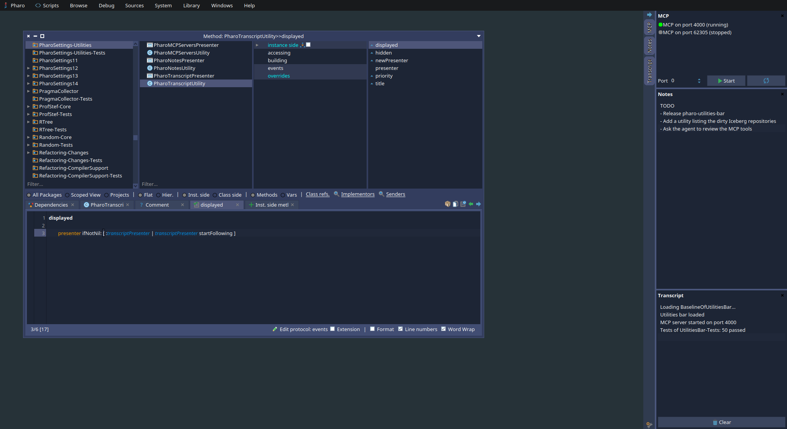
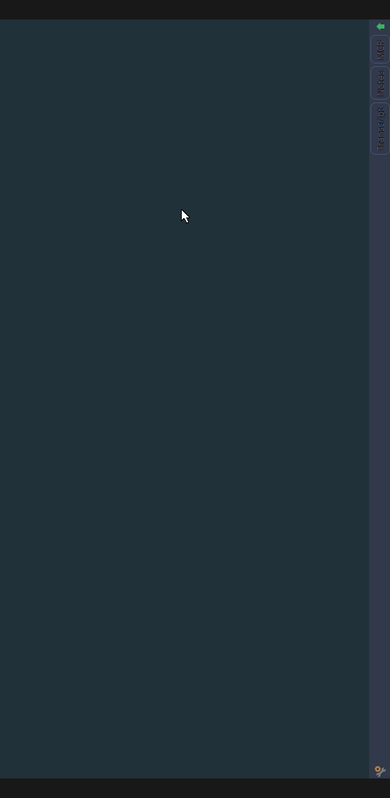
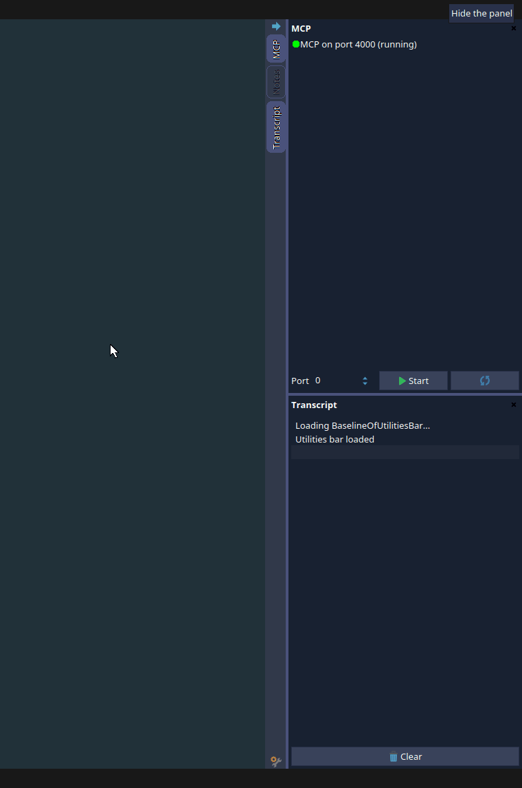
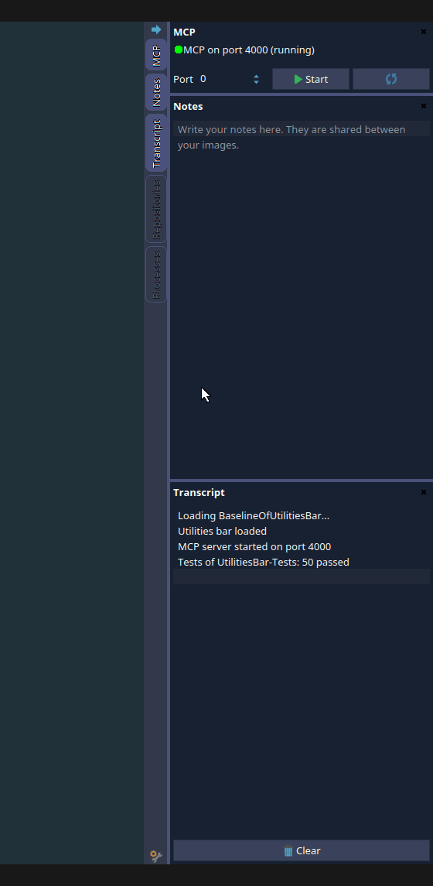
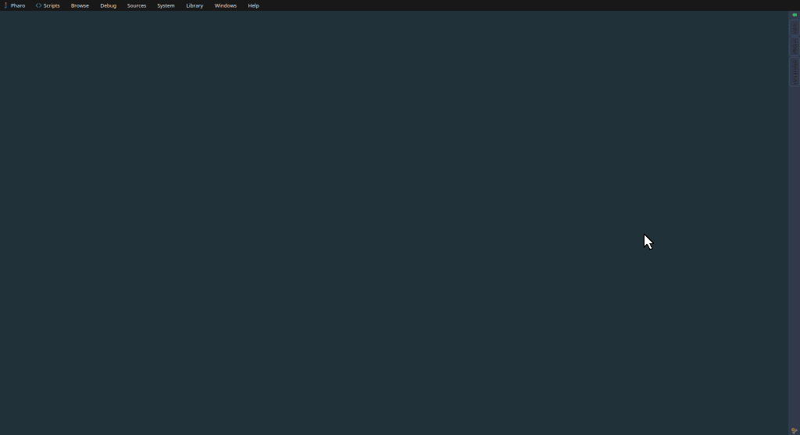
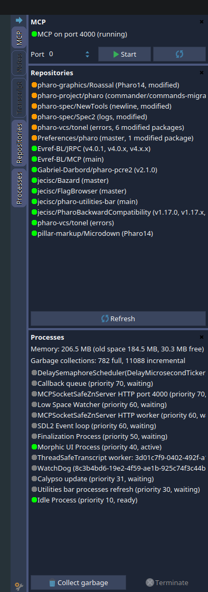

# pharo-utilities-bar

[](https://github.com/jecisc/pharo-utilities-bar/actions/workflows/ci.yml)

A collapsible bar of utilities docked on an edge of the Pharo IDE.



- [Installation](#installation)
- [Usage](#usage)
- [Settings](#settings)
- [Adding a utility](#adding-a-utility)
- [Example: the utilities of my pharo-scripts](#example-the-utilities-of-my-pharo-scripts)

## Installation

```smalltalk
Metacello new
	githubUser: 'jecisc' project: 'pharo-utilities-bar' commitish: 'main' path: 'src';
	baseline: 'UtilitiesBar';
	load
```

The bar opens on the right edge of the world as soon as it is loaded.

## Usage

Each utility adds a vertical tab to the bar. A tab tells whether its utility is active: clicking it shows or hides the panel of the utility, so several utilities can be displayed at the same time, stacked in the order of the tabs. The arrow at the top of the bar collapses the panels so that only the tabs remain visible, without changing which utilities are active. The cross in the header of a panel hides it.



Drag the inner edge of the panels to change their width, and the separators between panels to share the height between them. The heights are kept as proportions, so a small panel stays small when the screen or the taskbar changes size. Until you resize them, the panels of utilities declaring a default height get it, and the others share the remaining height.



Drag a tab to reorder the utilities: a line shows where the tab lands, and the panels follow the new order of the tabs.



Maximized windows do not cover the bar. The active utilities, the heights of their panels and the order of the tabs are kept when the bar is recreated, for example when the code of a utility changes.

## Settings

Click the settings icon at the bottom of the bar to edit its settings in the bar itself. The changes are applied when clicking the Save button, so unchecking the option showing the bar does not make it vanish while you edit.



The same settings are in the Settings browser, `Appearance > Morphic > Utilities bar`, which is also where a hidden bar can be shown again:
- Show utilities bar
- Edge: right or left
- Panel width: the width of the panels. It can also be changed by dragging the inner edge of the panels

The bar can also be recreated with `UtilitiesBarMorph reset`.

## Adding a utility

A utility is a subclass of `UtilitiesBarUtility` answering a title and a Spec presenter. The bar finds the utilities by looking at the subclasses of `UtilitiesBarUtility`, so there is nothing to register: the bar is updated as soon as the class is created, changed or removed.

```smalltalk
UtilitiesBarUtility << #MyUtility
	package: 'MyPackage'

MyUtility >> title
	^ 'My utility'

MyUtility >> newPresenter
	^ SpTextPresenter new
		text: 'Hello';
		yourself
```

What a utility can override:

| Method | Default | Purpose |
| --- | --- | --- |
| `#title` | the class name | The label of the tab and of the panel. It also identifies the utility when the bar restores its layout, so keep it unique. |
| `#newPresenter` | subclass responsibility | The Spec presenter displayed in the panel. |
| `#buildContent` | `self newPresenter build` | Override it instead of `#newPresenter` to display a Morph. |
| `#priority` | `100` | The order of the tabs, lowest first. Utilities with the same priority are sorted by title. Once the user reorders the tabs by dragging them, their order prevails and the utilities the user never placed go at the end. |
| `#defaultHeight` | `nil` | The height in pixels of the panel until the user resizes the panels. Useful for small utilities. Without it, the panel shares the height of the bar with the other ones. |
| `#displayed` and `#hidden` | nothing | Sent by the bar when the panel of the utility becomes visible and when it stops being visible (hidden, bar collapsed or deleted). Use them to only do costly work, such as following a source of updates, while the panel is visible. |
| `UtilitiesBarUtility class >> #isAvailable` | `true` for concrete classes | Answer `false` to hide the utility, for example when a dependency it needs is missing. |

The content is built the first time the panel is shown and kept while the bar lives, so its state survives hiding and showing the panel.

Since utilities subclass `UtilitiesBarUtility`, the package defining them must be loaded after the utilities bar. In a baseline, declare the dependency:

```smalltalk
spec
	baseline: 'UtilitiesBar' with: [ spec repository: 'github://jecisc/pharo-utilities-bar:main/src' ];
	package: 'MyPackage' with: [ spec requires: #( 'UtilitiesBar' ) ]
```

## Example: the utilities of my pharo-scripts

My [pharo-scripts](https://github.com/jecisc/pharo-scripts), the settings loaded in all my Pharo images, define five utilities. The first three were added in [this commit](https://github.com/jecisc/pharo-scripts/commit/4e68cea8c21825416071b8fc61b92954e9c89c37) and the two others in [this one](https://github.com/jecisc/pharo-scripts/commit/e7ebefd98f844be3683fcf097e34ec2da766a069).



**MCP** ([utility](https://github.com/jecisc/pharo-scripts/blob/master/settings/PharoSettings-Utilities/PharoMCPServersUtility.class.st), [presenter](https://github.com/jecisc/pharo-scripts/blob/master/settings/PharoSettings-Utilities/PharoMCPServersPresenter.class.st)) lists the servers of [MCP](https://github.com/Evref-BL/MCP) running in the image, with their port and a dot telling their state: green when running and listening, orange when the server and its socket disagree, gray when stopped. A port input and a button start a new server. When MCP is not loaded, the panel only displays a button to load it: the presenter looks the `MCP` class up in the environment instead of referencing it, so the utility can be loaded without MCP. An image usually has a single server, so the utility declares a small default height and its list can shrink to one row:

```smalltalk
PharoMCPServersUtility >> defaultHeight
	^ 92
```

**Notes** ([utility](https://github.com/jecisc/pharo-scripts/blob/4e68cea8c21825416071b8fc61b92954e9c89c37/settings/PharoSettings-Utilities/PharoNotesUtility.class.st), [presenter](https://github.com/jecisc/pharo-scripts/blob/4e68cea8c21825416071b8fc61b92954e9c89c37/settings/PharoSettings-Utilities/PharoNotesPresenter.class.st)) is a text area saved at each change in the cache folder of the playground, which my settings share between all my images.

**Transcript** ([utility](https://github.com/jecisc/pharo-scripts/blob/4e68cea8c21825416071b8fc61b92954e9c89c37/settings/PharoSettings-Utilities/PharoTranscriptUtility.class.st), [presenter](https://github.com/jecisc/pharo-scripts/blob/4e68cea8c21825416071b8fc61b92954e9c89c37/settings/PharoSettings-Utilities/PharoTranscriptPresenter.class.st)) displays the Transcript. It shows how to use `#displayed` and `#hidden`: the presenter only listens to the new entries of the Transcript while its panel is visible, so a hidden transcript does not slow down the image.

```smalltalk
PharoTranscriptUtility >> newPresenter
	^ presenter := PharoTranscriptPresenter on: Transcript

PharoTranscriptUtility >> displayed
	presenter ifNotNil: [ :transcriptPresenter | transcriptPresenter startFollowing ]

PharoTranscriptUtility >> hidden
	presenter ifNotNil: [ :transcriptPresenter | transcriptPresenter stopFollowing ]
```

**Repositories** ([utility](https://github.com/jecisc/pharo-scripts/blob/e7ebefd98f844be3683fcf097e34ec2da766a069/settings/PharoSettings-Utilities/PharoRepositoriesUtility.class.st), [presenter](https://github.com/jecisc/pharo-scripts/blob/e7ebefd98f844be3683fcf097e34ec2da766a069/settings/PharoSettings-Utilities/PharoRepositoriesPresenter.class.st)) lists the Iceberg repositories of the image, the modified ones first, with their branch, their number of modified packages and a dot: orange when modified, green when clean, red when the clone is missing. Double clicking a repository opens its working copy. While its panel is visible, it listens to the announcements of Iceberg to stay up to date.

**Processes** ([utility](https://github.com/jecisc/pharo-scripts/blob/e7ebefd98f844be3683fcf097e34ec2da766a069/settings/PharoSettings-Utilities/PharoProcessesUtility.class.st), [presenter](https://github.com/jecisc/pharo-scripts/blob/e7ebefd98f844be3683fcf097e34ec2da766a069/settings/PharoSettings-Utilities/PharoProcessesPresenter.class.st)) displays the memory of the image, its garbage collections and its processes, with a dot: green when running or ready, gray when waiting, orange when suspended (often a process stopped in a debugger). Buttons collect the garbage and terminate the selected process. It refreshes itself every two seconds, only while its panel is visible.

The [baseline of my settings](https://github.com/jecisc/pharo-scripts/blob/4e68cea8c21825416071b8fc61b92954e9c89c37/settings/BaselineOfPharoSettings/BaselineOfPharoSettings.class.st) loads the utilities bar before the utilities. It uses my local clone of the utilities bar when there is one, so that my images load it without network, and GitHub otherwise:

```smalltalk
BaselineOfPharoSettings >> utilitiesBarRepository: spec
	| sourcesDirectory |
	sourcesDirectory := StartupPreferencesLoader preferencesGeneralFolder / 'GitRepositories' / 'jecisc' / 'pharo-utilities-bar' / 'src'.
	spec baseline: 'UtilitiesBar' with: [
		spec repository: (sourcesDirectory exists
			ifTrue: [ 'tonel://' , sourcesDirectory fullName ]
			ifFalse: [ 'github://jecisc/pharo-utilities-bar:main/src' ]) ]
```
